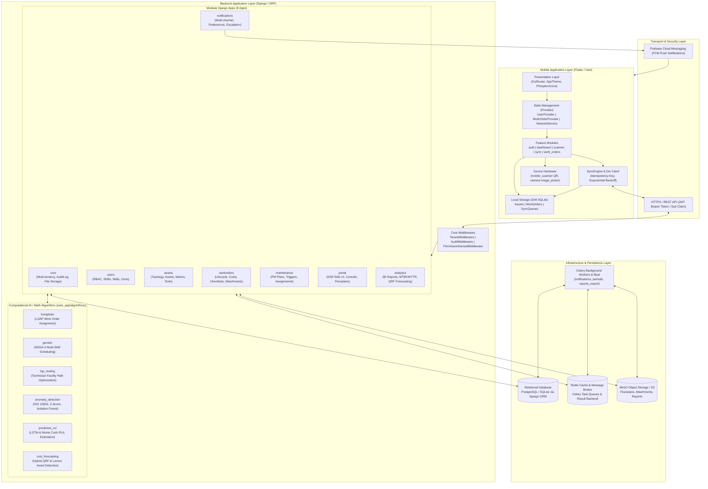
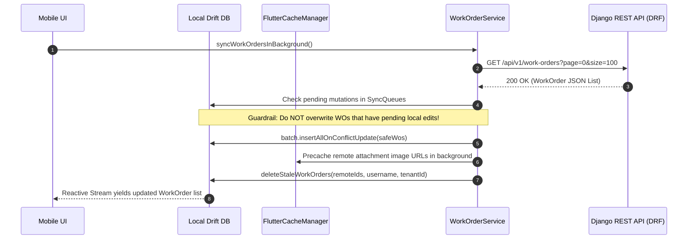
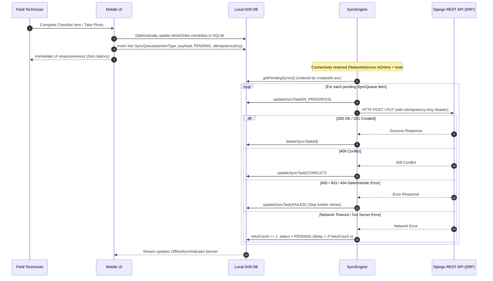

# Enterprise Asset Management (EAM) System Architecture

This document provides a comprehensive, end-to-end architectural specification for the Enterprise Asset Management (EAM) platform. The system is designed to provide mission-critical industrial asset management, condition monitoring, AI-driven maintenance scheduling, and offline-first mobile field operations for technicians.

---

## 1. High-Level System Architecture

The platform is structured across three core architectural pillars:
1. **Backend Layer (`eam_app/`)**: High-performance Python/Django REST Framework backend powering business logic, multi-tenancy, RBAC, Celery background tasks, and advanced mathematical/AI optimization engines.
2. **Mobile Application Layer (`mobile_app/`)**: Cross-platform Flutter client engineered with feature-driven architecture, local state management, camera hardware scanning, and interactive CAD floorplan visualization.
3. **Data & Offline-Sync Layer**: Hybrid storage combining PostgreSQL/SQLite backend relational databases, MinIO S3 object storage, Redis caches/message brokers, and an offline SQLite database managed by Drift on the mobile device with bidirectional synchronization.

### System Architecture Diagram



---

## 2. Pillar 1: Backend Layer Architecture (`eam_app/`)

The backend is built with Django 6.1 and Django REST Framework (DRF), following a strictly decoupled modular design. Every tenant-owned model inherits from `core.models.BaseTenantModel`.

### 2.1 The 8 Django Apps Breakdown

| App Name | Responsibility & Domain | Key Models & Entities |
| :--- | :--- | :--- |
| **`core`** | Platform foundation, multi-tenant isolation context, automated audit trails, central exception handling, and object storage management. | `Tenant`, `BaseTenantModel`, `AuditLog`, `DummyTenantModel` |
| **`users`** | Identity, authentication, fine-grained RBAC, and workforce management (technician skills, certifications, shift schedules). | `User`, `Role`, `Permission`, `TechnicianProfile`, `WorkforceSkill`, `CertificationType`, `UserCertification`, `ShiftTemplate`, `TechnicianSchedule`, `InviteToken` |
| **`assets`** | Enterprise asset registry, physical tree topology, CAD floorplan coordinates, MRO spare parts, specialized tool calibration/reservations, telemetry meter readings, and condition alerts. | `Location`, `AssetCategory`, `HierarchyTemplate`, `Asset`, `SparePart`, `StockTransaction`, `Tool`, `ToolInstance`, `ToolReservation`, `MeterReading`, `AssetAnomalyAlert`, `AssetRulPrediction` |
| **`workorders`** | Work order lifecycle management, step checklists, multi-media attachments, labor time logs, material consumption, and frozen cost breakdowns. | `WorkOrder`, `WorkOrderChecklistItem`, `WorkOrderAttachment`, `WorkOrderMaterial`, `LaborLog`, `WorkOrderCost`, `GAOptimizationJob` |
| **`maintenance`** | Reliability-Centered Maintenance (RCM) and Preventive Maintenance (PM) schedules, trigger engines (time, usage, sensor meters). | `PmPlan`, `PmPlanChecklistItem`, `PmPlanMaterial`, `PmPlanAssignment` |
| **`portal`** | Server-Side Rendered (SSR) web console for system administrators, asset managers, and planners. Interactive floorplans and KPI dashboards. | SSR Views, Templates, Navigation Context Processors |
| **`notifications`** | Multi-channel messaging (In-App, Email, Mobile Push via FCM), Out-Of-Office (OOO) delegation, actionable workflows, SLA escalations. | `Notification`, `NotificationPreference`, `DevicePushToken` |
| **`analytics`** | Executive dashboards, asynchronous report export engine (Excel, PDF, CSV), reliability engineering (MTBF, MTTR, Availability), cost forecasting. | `ExportJob`, `BudgetForecast`, `TenantFinancialSetting`, `PeriodApprovedBudget` |

### 2.2 API Architecture & Authentication

- **Routing Structure**: All endpoints are cleanly prefixed under `/api/v1/`:
  - `/api/v1/auth/` & `/api/v1/users/` (`users.urls`): Authentication, user profiling, role assignment.
  - `/api/v1/core/` (`core.urls`): System tenant settings, audit logs, file uploads.
  - `/api/v1/assets/` (`assets.urls`): Locations, asset hierarchies, QR code lookups, meter logs.
  - `/api/v1/work-orders/` (`workorders.urls`): Work order CRUD, auto-assignment preview/apply, attachments, checklists.
  - `/api/v1/pm-plans/` (`maintenance.urls`): Preventive maintenance definitions and assignments.
  - `/api/v1/notifications/` (`notifications.urls`): Notification listing, mark-read, action resolution.
  - `/api/v1/dashboard/` & `/api/v1/reports/` (`analytics.urls`, `analytics.report_urls`): KPI summaries, trends, export jobs.
  - `/api/v1/cost-forecasting/` (`analytics.cost_forecasting_urls`): QRF model forecasting and lemon asset reviews.
  - `/api/v1/routing/` (`algorithms.tsp_routing.urls`): Facility routing and mid-shift path rerouting.
- **Authentication**: Stateless JSON Web Tokens (`rest_framework_simplejwt`) using HS256 signatures:
  - Access Token Lifetime: 1 day; Refresh Token Lifetime: 7 days.
  - Custom JWT Claims: `sub` (User ID), `username`, `roles`, `permissions`, and `tenant_id`.
  - Fallback Session Authentication supported for SSR web portal access.
- **Multi-Tenancy Guardrail**:
  - `TenantMiddleware` extracts the tenant ID from request headers (`X-Tenant-ID`) or JWT token claims.
  - Thread-local context storage (`core.tenant_context.set_current_tenant`) ensures that database queries executed via `TenantManager` automatically filter by `tenant_id`.

### 2.3 Computational Modules & Algorithms (`eam_app/algorithms/`)

The platform integrates 6 specialized computational and machine-learning engines:

1. **Hungarian Assignment Optimization (`algorithms/hungarian/`)**:
   - Solves the Linear Sum Assignment Problem (LSAP) via the Kuhn-Munkres algorithm.
   - Evaluates multi-criteria cost matrices: technician skill competency match, travel distance between zones, shift schedule overlap, active workload balance, priority weighting (`BIG_M`), and shared tool conflict avoidance.
2. **Genetic Algorithm Multi-Objective Scheduler (`algorithms/genetic/`)**:
   - NSGA-II metaheuristic engine for scheduling work orders across multi-shift, multi-technician horizons.
   - Pareto-optimal front generation optimizing competing objectives: minimization of plant downtime, travel distance, and technician overtime fatigue.
3. **Traveling Salesperson Route Optimization (`algorithms/tsp_routing/`)**:
   - Generates optimal technician travel routes inside industrial complexes.
   - Computes distance matrices factoring in CAD floor coordinates, cross-floor transit via staircases and elevators, warehouse pit-stops for specialized tools/spare parts, and real-time mid-shift dynamic rerouting.
4. **Condition Monitoring & Anomaly Detection (`algorithms/anomaly_detection/`)**:
   - Real-time evaluation of asset telemetry against ISO 10816 vibration severity standards.
   - Combines statistical Z-Score thresholding, Isolation Forest outlier detection, and Theil-Sen robust linear regression for sensor drift identification.
5. **Remaining Useful Life (RUL) Prediction (`algorithms/predictive_rul/`)**:
   - Prognostics and health management (PHM) estimation for critical rotating machinery.
   - Features operating day vs. calendar day conversion based on duty cycles, Monte Carlo dropout uncertainty intervals (90% confidence), and protection algorithms against "phantom recovery" traps (artificial baseline resets post-greasing).
6. **Maintenance Cost Forecasting (`algorithms/cost_forecasting/`)**:
   - Quantile Regression Forests (QRF) combining deterministic PM schedules with probabilistic corrective maintenance costs.
   - Integrates "Lemon" asset detection (assets whose cumulative repair costs surpass replacement thresholds), annual inflation rates, and contingency buffer allocations.

### 2.4 Reliability Engineering Metrics (RCM)

Implemented within `analytics.services.ReliabilityMetricsService`:
- **Mean Time Between Failures (MTBF)**:
  $$\text{MTBF} = \frac{\text{Total Operating Hours}}{\text{Number of Technical Failures}}$$
  *Strict Guardrails*: Corrective, Emergency, and Breakdown orders only; Preventive Maintenance (PM) is strictly excluded. Zero-division guardrails display `100% Khả dụng (0 Sự cố)` when no failures occur.
- **Mean Time To Repair (MTTR)**:
  $$\text{MTTR} = \frac{\sum \text{Downtime of Completed Failures}}{\text{Count of Completed Failures}}$$
  *Outlier Filtering*: Durations outside $(0, 168.0\text{ hours}]$ are excluded as data anomalies.
- **Plant Availability**:
  $$\text{Availability} = \frac{\text{MTBF}}{\text{MTBF} + \text{MTTR}} \times 100\%$$
- **Hamilton-Hare Largest Remainder Method**: Guarantees that categorical breakdown percentages across dashboards and reports strictly total 100.0%.

---

## 3. Pillar 2: Mobile Application Layer (`mobile_app/`)

The mobile application is a production-grade Flutter client built for Android and iOS, optimized for technicians operating in offline environments such as underground utility tunnels, basements, or shielded industrial facilities.

### 3.1 Mobile Architecture & Directory Structure

```
mobile_app/lib/
├── main.dart                               # Entrypoint: MultiProvider, Firebase, SyncEngine initialization
├── core/
│   ├── constants/api_constants.dart       # Endpoints, base URLs, timeouts
│   ├── database/
│   │   ├── app_database.dart              # Drift SQLite Database, DAOs, schema migrations
│   │   ├── app_database.g.dart            # Generated Drift accessor bindings
│   │   └── database_mapper.dart           # Entity <-> Domain Model mapping logic
│   ├── network/
│   │   ├── dio_client.dart                # Dio HTTP client, JWT interceptor, base options
│   │   └── network_service.dart           # Connectivity listener (connectivity_plus)
│   ├── providers/user_provider.dart       # User authentication and profile state
│   ├── routes/app_router.dart             # Declarative GoRouter with auth redirection guards
│   └── theme/app_theme.dart               # Colors, typography, component styles
└── features/
    ├── auth/                              # LoginScreen, AuthService, secure token storage
    ├── dashboard/                         # MainLayout, HomeScreen, EquipmentScreen, CalendarScreen
    │   ├── screens/floorplan_viewer_screen.dart # Interactive CAD floorplan viewer with CustomPainter
    │   └── screens/notifications_screen.dart   # Real-time notification list & actions
    ├── scanner/                           # Hardware QR/Barcode scanner via mobile_scanner
    ├── sync/                              # Offline synchronization engine and indicator
    │   ├── presentation/widgets/offline_sync_indicator.dart # Sticky status header
    │   └── services/sync_engine.dart      # Background sync loop, exponential backoff
    └── work_orders/                       # Work order lists, details, creation, checklist execution
        ├── services/tsp_routing_service.dart   # Route optimization client
        ├── widgets/route_map_painter.dart      # CustomPainter CAD route visualizer
        └── widgets/swipeable_checklist_tile.dart # Interactive checklist tiles
```

### 3.2 State Management & Networking

- **Provider (`provider: ^6.1.5`)**:
  - `UserProvider`: Manages logged-in technician identity, permissions, tenant context, and active shifts.
  - `WorkOrderProvider`: Manages work order stream subscriptions from Drift, filter criteria, and search queries.
  - `NetworkService`: Subscribes to `connectivity_plus` to expose reactive online/offline states across the widget tree.
- **Routing (`go_router: ^17.2.3`)**:
  - Top-level `rootNavigatorKey` with authentication redirection guard.
  - Deep-linkable parameter passing (`/work-order-detail/:id`, `/floorplan-viewer`, `/technician-route`).
- **Networking (`dio: ^5.9.2`)**:
  - Configured with `connectTimeout: 15s` and `receiveTimeout: 15s`.
  - Interceptors automatically append `Authorization: Bearer <token>` and `Idempotency-Key: <uuid>`.

### 3.3 Hardware Integration & Specialized UI Components

- **Barcode/QR Scanner (`mobile_scanner: ^7.2.0`)**: Backed by device hardware camera with automated haptic feedback (`HapticFeedback.vibrate()`). Performs an immediate local Drift database lookup first, fetching remote asset metadata asynchronously.
- **Interactive Floorplan CAD Viewer (`FloorplanViewerScreen`)**:
  - Supports 2D plant visualization using `InteractiveViewer` and `TransformationController` for fluid pinch-to-zoom and panning.
  - Multi-floor navigation, asset pin hotspots, dynamic bounding boxes, and cross-floor transition markers (stairs/elevators).
- **Technician Route Visualizer (`RouteMapPainter`)**:
  - Custom canvas renderer drawing dark CAD layout grids (`#0f172a`), facility zone boundaries, animated pulse indicators for active work orders, and directional path lines.
- **Swipeable Checklist Execution (`SwipeableChecklistTile`)**:
  - Powered by `flutter_slidable`. Supports pass/fail toggles, numeric readings with validation, and mandatory item restrictions before work order completion.

---

## 4. Pillar 3: Data & Offline-Sync Layer

The offline sync architecture guarantees zero data loss in disconnected environments while maintaining multi-tenant security and preventing update conflicts.

### 4.1 Mobile Local SQLite Schema (Drift)

Managed via `drift` (`drift: ^2.18.0`, `sqlite3_flutter_libs: ^0.5.21`):

1. **`Assets` Table**:
   - `id` (Text, PK), `name` (Text), `qrCode` (Text, nullable), `locationName` (Text, nullable), `tenantId` (Text), `isActive` (Bool), `lastUpdated` (DateTime), `rawJson` (Text, nullable).
   - *DAO Operations*: `getAllAssets(tenantId)`, `getAssetByQrCode(qrCode, tenantId)`, `insertAllAssets(batch)`.
2. **`WorkOrders` Table**:
   - `id` (Text, PK), `title` (Text), `description` (Text), `status` (Text), `priority` (Text, nullable), `assetId` (Text, nullable), `assetName` (Text, nullable), `assetLocation` (Text, nullable), `deadline` (DateTime, nullable), `updatedAt` (DateTime, nullable), `assigneeUsername` (Text, nullable), `resolutionNotes` (Text, nullable), `checklists` (Text with JSON `ChecklistConverter`), `attachments` (Text with JSON `ChecklistConverter`), `tenantId` (Text).
   - *DAO Operations*: `watchMyWorkOrders(username, tenantId)`, `getMyWorkOrders()`, `insertOrUpdateWorkOrder()`, `deleteStaleWorkOrders()`, `deleteOldCompletedWorkOrders()`.
3. **`SyncQueues` Table**:
   - `id` (Int, AutoIncrement, PK), `actionType` (Text), `payload` (Text, JSON), `status` (Text: `PENDING`, `IN_PROGRESS`, `FAILED`, `CONFLICT`), `createdAt` (DateTime), `retryCount` (Int), `tenantId` (Text), `idempotencyKey` (Text, nullable).
   - *DAO Operations*: `watchPendingSyncs()`, `getPendingSyncs()`, `addSyncTask()`, `updateSyncTask()`, `deleteSyncTask()`.

### 4.2 Data Model Entity Relationship Diagram (ERD)

The following diagram maps the comprehensive data model across the backend relational schema and the mobile Drift sync entities:

```mermaid
erDiagram
    TENANT ||--o{ USER : "has"
    TENANT ||--o{ ROLE : "defines"
    TENANT ||--o{ LOCATION : "owns"
    TENANT ||--o{ ASSET : "owns"
    TENANT ||--o{ WORK_ORDER : "tracks"
    TENANT ||--o{ PM_PLAN : "configures"
    TENANT ||--o{ NOTIFICATION : "dispatches"

    USER ||--o{ USER_ROLE : "assigned"
    ROLE ||--o{ USER_ROLE : "held_by"
    ROLE ||--o{ ROLE_PERMISSION : "grants"
    PERMISSION ||--o{ ROLE_PERMISSION : "belongs_to"

    USER ||--o| TECHNICIAN_PROFILE : "has_profile"
    USER ||--o{ USER_CERTIFICATION : "holds"
    CERTIFICATION_TYPE ||--o{ USER_CERTIFICATION : "categorizes"
    USER ||--o{ TECHNICIAN_SCHEDULE : "scheduled_in"
    SHIFT_TEMPLATE ||--o{ TECHNICIAN_SCHEDULE : "applies_to"

    LOCATION ||--o{ LOCATION : "parent_of"
    LOCATION ||--o{ ASSET : "contains"
    LOCATION ||--o{ SPARE_PART : "stored_in"
    LOCATION ||--o{ TOOL : "stored_at"

    ASSET_CATEGORY ||--o{ ASSET : "classifies"
    ASSET ||--o{ ASSET : "child_of"
    ASSET ||--o{ METER_READING : "produces"
    ASSET ||--o{ ASSET_ANOMALY_ALERT : "triggers"
    ASSET ||--o{ ASSET_RUL_PREDICTION : "predicts"
    ASSET ||--o{ WORK_ORDER : "subject_of"
    ASSET ||--o{ PM_PLAN_ASSIGNMENT : "monitored_by"

    SPARE_PART ||--o{ STOCK_TRANSACTION : "logged_in"
    SPARE_PART ||--o{ WORK_ORDER_MATERIAL : "consumed_by"
    TOOL ||--o{ TOOL_INSTANCE : "instantiates"
    TOOL_INSTANCE ||--o{ TOOL_RESERVATION : "reserved_for"
    WORK_ORDER ||--o{ TOOL_RESERVATION : "requires_tool"

    PM_PLAN ||--o{ PM_PLAN_CHECKLIST : "specifies"
    PM_PLAN ||--o{ PM_PLAN_MATERIAL : "specifies"
    PM_PLAN ||--o{ PM_PLAN_ASSIGNMENT : "assigns"
    PM_PLAN ||--o{ WORK_ORDER : "generates"

    WORK_ORDER ||--o{ WORK_ORDER_CHECKLIST : "contains"
    WORK_ORDER ||--o{ WORK_ORDER_ATTACHMENT : "includes"
    WORK_ORDER ||--o{ WORK_ORDER_MATERIAL : "consumes"
    WORK_ORDER ||--o{ LABOR_LOG : "records"
    WORK_ORDER ||--o| WORK_ORDER_COST : "evaluates"

    USER ||--o{ NOTIFICATION : "receives"
    USER ||--o{ NOTIFICATION_PREFERENCE : "configures"
    USER ||--o{ DEVICE_PUSH_TOKEN : "registers"

    %% Mobile Drift Schema Boundary & Bidirectional Links
    ASSET ||--o{ DRIFT_ASSET : "cached_to"
    WORK_ORDER ||--o{ DRIFT_WORK_ORDER : "synced_bidirectionally"
    DRIFT_WORK_ORDER ||--o{ DRIFT_SYNC_QUEUE : "enqueues_mutations"

    DRIFT_ASSET {
        string id PK
        string name
        string qrCode
        string locationName
        string tenantId
        boolean isActive
    }
    DRIFT_WORK_ORDER {
        string id PK
        string title
        string status
        string priority
        string assetId
        string tenantId
    }
    DRIFT_SYNC_QUEUE {
        int id PK
        string actionType
        string status
        string tenantId
        string idempotencyKey
    }
```



---

## 5. Bidirectional Offline Synchronization Lifecycle

The synchronization protocol utilizes an optimistic offline-first model: local actions update the mobile SQLite database immediately and enqueue atomic mutations into `SyncQueues`.

### 5.1 Downstream Sync (Server to Mobile)



### 5.2 Upstream Sync (Mobile to Server)



### 5.3 Automated Local Storage Eviction & Cache Pruning

To keep SQLite database size minimal on edge mobile devices, the following background eviction policies run automatically:
- **Orphaned Assets Pruning**: Any asset not referenced by active work orders and older than 30 days is purged via `deleteOrphanedAssets()`.
- **Completed Work Orders Pruning**: Completed work orders older than 7 days are purged from mobile device storage via `deleteOldCompletedWorkOrders()`.
- **Remote Reconciliation**: During background work order synchronization, local records missing from the remote payload are cleaned up via `deleteStaleWorkOrders()`.

---

## 6. Security, Multi-Tenancy & Infrastructure

### 6.1 Multi-Tenant Data Isolation
- **Row-Level Tenancy**: All models inherit `BaseTenantModel`, attaching `tenant_id` foreign keys and enforcing query segregation via custom `TenantManager`.
- **Audit Trails**: Every database mutation (`CREATE`, `UPDATE`, `DELETE`) automatically logs the actor ID, entity class, and timestamp into `AuditLog`.
- **Tenant Context Protection**: Bypassing tenant filtering is restricted to system background jobs using `Model.all_objects`.

### 6.2 Asynchronous Tasks & Celery Queue Topology

Celery manages background processes via Redis brokers across dedicated queues:

| Queue Name | Purpose & Tasks | Schedule / Trigger |
| :--- | :--- | :--- |
| **`notifications`** | Async delivery of emails, webhooks, and FCM push notifications. | Triggered on Work Order assignment, status changes, and critical anomaly alerts. |
| **`periodic`** | PM schedule evaluations (`evaluate_triggers`), SLA escalation scans, zombie export job cleanup, and fallback file syncs. | Periodic (Every 5 minutes / Daily via Celery Beat). |
| **`reports_export`** | Heavyweight report compilation (Excel, PDF, CSV) with MinIO object storage uploads. | On-demand user export request. |
| **`default`** | General purpose asynchronous operations. | Standard application dispatches. |

---

## 7. Verification & Codebase Validation Commands

The test suite ensures the stability of both the backend algorithms and mobile components:

### Backend Test Execution
```bash
# Run all algorithmic & governance test suites
python eam_app/manage.py test algorithms.tests

# Run analytics, MTBF/MTTR, and dashboard KPI test suites
python eam_app/manage.py test analytics.tests

# Run core tenancy and audit middleware tests
python eam_app/manage.py test core.tests
```

### Mobile Test Execution
```bash
# Navigate to mobile application directory
cd mobile_app

# Run all unit and model parsing tests
flutter test test/notifications_test.dart
```
