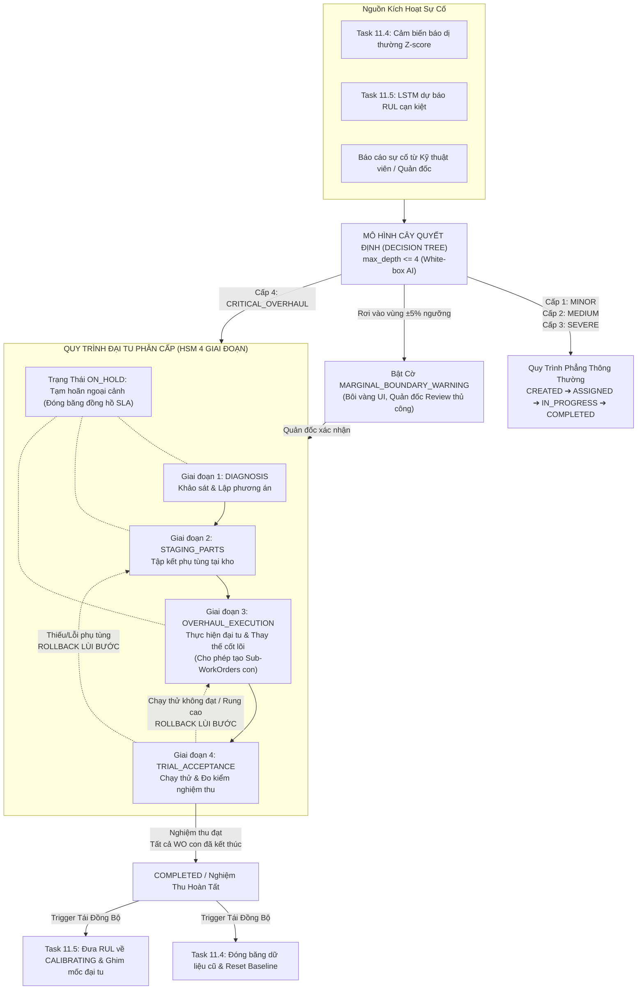

# Thiết Kế Hệ Thống & Đặc Tả Kỹ Thuật: Task 11.8 — Complex Maintenance Workflow & Facility Management (Decision Tree & HSM)

Tài liệu này xác định kiến trúc điều phối quy trình đại tu chuyên sâu và quản lý cụm chi tiết cơ sở vật chất trong hệ thống Quản lý Tài sản Doanh nghiệp (EAM). Hệ thống giải quyết các bài toán hư hỏng thiết bị phức tạp thông qua việc kết hợp:
1. Mô hình cây quyết định giải thích được (**Explainable Decision Tree Classifier**) với **vùng đệm cảnh báo giáp ranh (Marginal Boundary Warning)** để tự động phân cấp mức độ sự cố.
2. Máy trạng thái phân cấp 4 giai đoạn tinh gọn (**Hierarchical State Machine - HSM**) phục vụ riêng cho các ca sửa chữa lớn / đại tu thay thế cốt lõi (`CORE_REPLACEMENT`).
3. Cơ chế **lùi bước kỹ thuật linh hoạt (Rollback)** và **đóng băng đồng hồ đo thời gian tạm hoãn ngoại cảnh (`ON_HOLD` Clock-Paused SLA)**.
4. Điều kiện **nghiệm thu phiếu đại tu cha dựa trên tập trạng thái kết thúc (Terminal States)** của các phiếu công việc con (Sub-WorkOrders).
5. Danh mục cây cụm chi tiết thiết bị 3-4 tầng (**Facility Component Catalog**).
6. Cầu nối **tái đồng bộ đường cơ sở sau đại tu (Post-Overhaul Baseline Reset Bridge)** trực tiếp sang **Task 11.4 (Phát hiện dị thường cảm biến)** và **Task 11.5 (LSTM dự đoán tuổi thọ RUL)**.

Tài liệu đóng vai trò là **Đặc Tả Kỹ Thuật & Chuẩn Kiểm Thử (Technical Specification & Audit Baseline)** bám sát $100\%$ cam kết tại Đề cương tốt nghiệp đại học đã nộp cho nhà trường.

---

## 1. Mục Tiêu & Cơ Sở Khoa Học Theo Đề Cương Tốt Nghiệp

Trong Đề cương tốt nghiệp [`DeCuong_1150080143_VoAnhKiet.docx`](file:///C:/Users/Admin/Downloads/DATN/DeCuong_1150080143_VoAnhKiet.docx), yêu cầu nghiệp vụ được cam kết nguyên văn tại **Mục 104 (Kết quả dự kiến đạt được)** và **Mục 3.1.2 (Quy trình nghiệp vụ cốt lõi)**:
> *"Chức năng quản lý quy trình bảo trì hoàn thiện có khả năng theo dõi cơ sở vật chất, được xây dựng từ **mô hình cây quyết định Decision Tree phân loại mức độ sự cố kết hợp giải thuật máy trạng thái phân cấp Hierarchical State Machine** nhằm tự động thiết lập luồng quy trình xử lý riêng biệt cho các ca hỏng hóc phức tạp cần sửa chữa nhiều lần, kết hợp hệ thống báo cáo động toàn diện cho ban quản lý."*

### 1.1. Bản Chất Nghiệp Vụ Của Bài Toán Đại Tu (Major Overhaul)
Trong bảo trì công nghiệp, các sự cố nhỏ (châm dầu, siết ốc, thay bóng đèn, vệ sinh lọc gió) chỉ cần máy trạng thái phẳng thông thường (`CREATED` $\rightarrow$ `ASSIGNED` $\rightarrow$ `IN_PROGRESS` $\rightarrow$ `COMPLETED`).
Tuy nhiên, đối với sự cố hỏng hóc nặng hoặc đại tu lớn (cháy stator máy phát điện, mòn vỡ ổ bi trục chính máy ép thủy lực, nứt cánh tuabin):
- **Thời gian dừng máy kéo dài** (hàng ngày hoặc hàng tuần), chi phí linh kiện và nhân công rất cao.
- **Quy trình nhiều bước bắt buộc**: Không thể vừa nhận phiếu là bấm hoàn thành ngay, mà phải trải qua: Khảo sát hiện trường $\rightarrow$ Tập kết đủ vật tư phụ tùng $\rightarrow$ Tháo máy & Thay thế linh kiện cốt lõi $\rightarrow$ Chạy thử đo đạc nghiệm thu.
- **Rủi ro chạy thử**: Khi chạy thử máy sau lắp ráp, nếu phát hiện độ rung lắc hoặc nhiệt độ bất thường, hệ thống bắt buộc phải có cơ chế **Lùi bước (Rollback)** để thợ kiểm tra căn chỉnh lại, không để máy lỗi được nghiệm thu đưa vào sản xuất.

### 1.2. Mối Quan Hệ Bổ Trợ Tự Nhiên Với Task 11.4 & Task 11.5
Task 11.8 không đứng biệt lập mà đóng vai trò là **Bộ điều hướng thông minh (Smart Dispatcher)** kết nối toàn bộ hệ thống AI:
- Khi cảm biến phát hiện dị thường rung chấn/nhiệt độ (**Task 11.4**) hoặc mô hình LSTM dự báo tuổi thọ còn lại cạn kiệt (**Task 11.5**), hệ thống tự động sinh Work Order.
- **Cây quyết định (Decision Tree - Task 11.8)** nhận các chỉ số từ 11.4 & 11.5 kết hợp với ước tính chi phí để phân loại:
  - Nếu là hỏng hóc thông thường $\rightarrow$ Điều hướng vào luồng Work Order phẳng thông thường (Phase 3).
  - Nếu là hỏng hóc kết cấu nặng $\rightarrow$ Kích hoạt luồng **HSM Đại Tu 4 Giai Đoạn**.
- Khi hoàn tất nghiệm thu ca đại tu, Task 11.8 gửi tín hiệu kích hoạt **Reset Baseline**: Đưa tuổi thọ RUL của Task 11.5 về trạng thái hiệu chuẩn mới (`CALIBRATING`) và đóng băng các dữ liệu rung chấn cũ của Task 11.4 (đã tích hợp trong `WorkOrderTransitionService`).

---

## 2. Ràng Buộc Kế Thừa Hệ Thống & Tái Sử Dụng Mã Nguồn

Hệ thống tận dụng tối đa các thành phần sẵn có trong codebase hiện tại:
- **Tái Sử Dụng Mô Hình Multi-Tenancy**: Mọi dữ liệu phân cấp cơ sở vật chất, liên kết phụ thuộc công việc và nhật ký chuyển bước kế thừa `BaseTenantModel`, bảo đảm phân lập tuyệt đối giữa các Tenant qua `TenantManager`.
- **Tái Sử Dụng Thực Thể Nghiệp Vụ Có Sẵn**:
  - `WorkOrder` ([workorders/models.py](file:///d:/GameLinkNeverDie/eam-enterprise-assset-management/eam_app/workorders/models.py)):
    - Tận dụng `parent_id`: Liên kết phiếu đại tu cha với các Sub-WorkOrders con.
    - Tận dụng `depends_on_wo`: Thứ tự phụ thuộc giữa các công việc con.
    - Tận dụng `maintenance_action`: Đánh dấu ca sửa chữa là `CORE_REPLACEMENT`.
    - Tận dụng `post_repair_vibration`, `post_repair_temperature`: Lưu số đo nghiệm thu sau sửa chữa.
    - Mở rộng thêm các trường: `severity_level`, `marginal_boundary_warning`, `current_hsm_stage`, `decision_path_explanation`, `override_reason`, `is_on_hold`, `hold_accumulated_seconds`.
  - `Asset` ([assets/models.py](file:///d:/GameLinkNeverDie/eam-enterprise-assset-management/eam_app/assets/models.py)):
    - Tận dụng `purchase_cost`, `value`: Dùng để tính tỷ lệ chi phí sửa chữa.
    - Tận dụng `current_rul_days`, `rul_risk_level`: Đầu vào trực tiếp từ mô hình LSTM Task 11.5.
  - `AssetAnomalyAlert` ([assets/models.py](file:///d:/GameLinkNeverDie/eam-enterprise-assset-management/eam_app/assets/models.py)):
    - Tận dụng `z_score`: Đầu vào trực tiếp từ cảm biến phát hiện dị thường Task 11.4.
  - `WorkOrderTransitionService` ([workorders/services.py](file:///d:/GameLinkNeverDie/eam-enterprise-assset-management/eam_app/workorders/services.py#L157-L174)):
    - Đã có sẵn logic kiểm tra `if wo.maintenance_action == 'CORE_REPLACEMENT'`: tự động đóng băng `MeterReading.is_pre_repair = True`, cập nhật `Asset.last_core_overhaul_at = now`, `rul_risk_level = 'CALIBRATING'` và giải quyết các cảnh báo dị thường `AssetAnomalyAlert.status = 'RESOLVED'`.
- **Kiến Trúc Đóng Gói Module Giải Thuật**: Toàn bộ mã nguồn giải thuật phân loại sự cố và điều phối máy trạng thái phân cấp được đặt riêng biệt tại:
  `eam_app/algorithms/decision_tree_hsm/`

---

## 3. Kiến Trúc Luồng Hoạt Động (Architecture & Workflow)



---

## 4. Đặc Tả 6 Quy Tắc Cốt Lõi (Core Rules)

### Quy Tắc 1: Cây Quyết Định Giải Thích Được & Vùng Đệm Cảnh Báo Giáp Ranh
- **Bản chất**: Sử dụng mô hình `DecisionTreeClassifier(max_depth=4, criterion='gini')` để phân loại sự cố vào 4 cấp độ rõ ràng:
  - **Cấp 1 (`LEVEL_1_MINOR`)**: Giờ dừng máy $< 2\text{h}$, tỷ lệ chi phí $< 2\%$ nguyên giá $\rightarrow$ Quy trình bảo dưỡng thông thường (`GENERAL`).
  - **Cấp 2 (`LEVEL_2_MEDIUM`)**: Thay thế linh kiện thông thường, dừng máy $2 - 8\text{h}$, chi phí $< 10\%$ $\rightarrow$ Bảo dưỡng vi mô (`MICRO_MAINTENANCE`).
  - **Cấp 3 (`LEVEL_3_SEVERE`)**: Dừng chuyền đột xuất, nguy cơ gián đoạn sản xuất $\rightarrow$ Quy trình ưu tiên cao (điều phối qua TSP Task 11.3).
  - **Cấp 4 (`LEVEL_4_CRITICAL_OVERHAUL`)**: Hư hỏng kết cấu nặng, dừng máy $> 8\text{h}$, chi phí $> 20\%$ nguyên giá máy, hoặc RUL chạm ngưỡng nguy hiểm $\rightarrow$ **Kích hoạt Quy trình HSM 4 Giai đoạn**.
- **Tính giải thích được (Explainable AI)**: Trích xuất $100\%$ đường dẫn cây quyết định dưới dạng chuỗi IF-THEN rõ ràng (Ví dụ: `Thời gian dừng máy (9.0h) > 8.0h ➔ Tỷ lệ chi phí (22.5%) > 20.0% ➔ Phân loại: CẤP 4 (ĐẠI TU)`).
- **Vùng đệm cảnh báo giáp ranh (Marginal Boundary Warning)**:
  - Nếu đặc trưng rơi vào vùng $\pm 5\%$ của ngưỡng phân chia (ví dụ chi phí từ $19.0\%$ đến $21.0\%$), hệ thống gắn cờ `marginal_boundary_warning = True`.
  - Giao diện người dùng bôi vàng kết quả cảnh báo và yêu cầu Quản đốc rà soát thủ công (**Human-in-the-loop**) để xác nhận hoặc ghi đè cấp độ.

### Quy Tắc 2: Quyền Can Thiệp Ghi Đè & Lùi Bước Kỹ Thuật (Override & Rollback)
- **Quyền ghi đè (Manager Override)**: Quản đốc có quyền ghi đè quyết định của AI (`manual_severity`) kèm lý do kỹ thuật (`override_reason`) bắt buộc $\ge 20$ ký tự, lưu vết vĩnh viễn vào nhật ký.
- **Cơ chế Lùi bước linh hoạt (Rollback)**:
  - Tại Giai đoạn 4 (`TRIAL_ACCEPTANCE`), nếu chạy thử đo rung hoặc nhiệt độ không đạt, Quản đốc có quyền bấm **Lùi bước (Rollback)** về Giai đoạn 3 (`OVERHAUL_EXECUTION`) để sửa lại, hoặc về Giai đoạn 2 (`STAGING_PARTS`) nếu cần đặt lại linh kiện khác.
  - Bắt buộc nhập lý do lùi bước (`rollback_reason`) $\ge 20$ ký tự.
  - Tự động thực hiện **Cascade Reset**: Đưa trạng thái các bước bị lùi về chế độ chờ thực hiện lại (`PENDING_REEXECUTION`).

### Quy Tắc 3: Máy Trạng Thái HSM 4 Giai Đoạn & Đóng Băng Đồng Hồ `ON_HOLD`
- Khi Work Order được xác định là Cấp 4, hệ thống kích hoạt thanh Stepper 4 bước tuần tự (chặn nhảy cóc giai đoạn):
  - **Giai đoạn 1 (`DIAGNOSIS`)**: Khảo sát hiện trường, xác định nguyên nhân hư hỏng, lập phương án kỹ thuật.
  - **Giai đoạn 2 (`STAGING_PARTS`)**: Kiểm đếm và tập kết đủ $100\%$ danh mục phụ tùng cần thiết tại kho/xưởng trước khi tháo máy.
  - **Giai đoạn 3 (`OVERHAUL_EXECUTION`)**: Tháo dỡ, gia công cơ khí, thay thế phụ tùng cốt lõi (`CORE_REPLACEMENT`). Tại giai đoạn này, cho phép tạo các **Sub-WorkOrders con** cho các nhóm thợ chuyên môn (Cơ khí, Điện, Đo lường).
  - **Giai đoạn 4 (`TRIAL_ACCEPTANCE`)**: Lắp ráp hoàn chỉnh, chạy thử không tải/có tải, ghi nhận số đo rung động RMS (`post_repair_vibration`) và nhiệt độ (`post_repair_temperature`).
- **Trạng thái tạm hoãn ngoại cảnh (`ON_HOLD`)**:
  - Cho phép Quản đốc tạm hoãn ở bất kỳ giai đoạn nào khi có trở ngại khách quan (chờ nhà cung cấp giao hàng, chờ phê duyệt ngân sách).
  - **Đóng băng đồng hồ (Clock-Paused)**: Toàn bộ thời gian nằm ở trạng thái `ON_HOLD` được cộng dồn vào `hold_accumulated_seconds` và **tự động trừ ra** khỏi tổng thời gian xử lý khi tính toán chỉ số MTTR và tuân thủ SLA tại Báo cáo phân hệ Task 10.2 & 10.3.

### Quy Tắc 4: Rào Chắn Nghiệm Thu Phiếu Cha Dựa Trên Phiếu Con (Sub-WorkOrder Gate)
- Trong một ca đại tu phức tạp, phiếu cha có thể sinh ra nhiều Sub-WorkOrders con cho các tổ thợ qua khóa ngoại `parent_id`.
- **Điều kiện đóng phiếu cha**: Phiếu đại tu cha chỉ được phép chuyển từ Giai đoạn 4 sang `COMPLETED` khi **$100\%$ các phiếu con đều nằm trong tập trạng thái kết thúc (Terminal States)**:
  $$\forall s \in \text{WorkOrder.sub\_tasks}, \quad s.\text{status} \in \{\text{'COMPLETED'}, \text{'CANCELLED'}\}$$
- Nếu còn bất kỳ phiếu con nào đang ở trạng thái `ASSIGNED`, `IN_PROGRESS` hoặc `ON_HOLD`, hệ thống khóa cứng việc đóng phiếu cha và báo lỗi: `ACTIVE_SUB_TASKS_REMAINING`.

### Quy Tắc 5: Cầu Nối Tái Đồng Bộ Đường Cơ Sở Sau Đại Tu (Post-Overhaul Baseline Reset)
- Ngay khi phiếu đại tu cha được nghiệm thu hoàn thành (`COMPLETED`), hệ thống tự động phát tín hiệu tái thiết lập toàn bộ pipeline giám sát:
  - **Reset Task 11.4**: Đóng băng toàn bộ các bản ghi `MeterReading` cũ trước mốc sửa chữa (`is_pre_repair = True`), chuyển trạng thái các cảnh báo dị thường `AssetAnomalyAlert` sang `RESOLVED`.
  - **Reset Task 11.5**: Cập nhật mốc đại tu `Asset.last_core_overhaul_at = now`, xóa cờ hồi phục ảo `is_phantom_recovery = False`, và đưa trạng thái rủi ro `rul_risk_level = 'CALIBRATING'` để bắt đầu tích lũy chu kỳ giám sát suy thoái mới.

### Quy Tắc 6: Cây Cụm Chi Tiết Cơ Sở Vật Chất (Facility Component Catalog)
- Quản lý cấu trúc phân cấp tài sản chuẩn mực:
  $$\text{Khu Vực / Xưởng (Location)} \longrightarrow \text{Thiết Bị (Asset)} \longrightarrow \text{Cụm Chi Tiết (Component)}$$
- Mỗi `FacilityComponent` đại diện cho một bộ phận trọng yếu của máy móc (ví dụ: *Ổ bi đỡ chặn, Hộp số giảm tốc, Cụm van tiết lưu, Cánh bơm tuabin*).
- Khi tạo Work Order hoặc đánh giá sự cố, người dùng có thể chỉ định rõ cụm chi tiết bị sự cố thông qua trường `component_id`.

---

## 5. Mô Hình Dữ Liệu & Khóa Ngoại (Data Model & Schema)

### 5.1. Bảng `facility_components` (Cụm chi tiết thiết bị)
```sql
CREATE TABLE facility_components (
    id UUID PRIMARY KEY DEFAULT gen_random_uuid(),
    tenant_id UUID NOT NULL REFERENCES tenants(id) ON DELETE CASCADE,
    asset_id UUID NOT NULL REFERENCES assets(id) ON DELETE CASCADE,
    parent_id UUID NULL REFERENCES facility_components(id) ON DELETE CASCADE,
    code VARCHAR(64) NOT NULL,
    name VARCHAR(255) NOT NULL,
    criticality VARCHAR(16) NOT NULL DEFAULT 'MEDIUM', -- 'LOW', 'MEDIUM', 'HIGH', 'CRITICAL'
    created_at TIMESTAMP WITH TIME ZONE DEFAULT CURRENT_TIMESTAMP,
    updated_at TIMESTAMP WITH TIME ZONE DEFAULT CURRENT_TIMESTAMP,
    CONSTRAINT uq_component_code_per_asset UNIQUE (tenant_id, asset_id, code)
);
CREATE INDEX idx_facility_components_asset ON facility_components(tenant_id, asset_id);
```

### 5.2. Mở rộng bảng `work_orders` (Bổ sung trường hỗ trợ Phân cấp & HSM)
```sql
ALTER TABLE work_orders
    ADD COLUMN severity_level VARCHAR(32) NULL, -- 'LEVEL_1_MINOR', 'LEVEL_2_MEDIUM', 'LEVEL_3_SEVERE', 'LEVEL_4_CRITICAL_OVERHAUL'
    ADD COLUMN marginal_boundary_warning BOOLEAN DEFAULT FALSE,
    ADD COLUMN decision_path_explanation TEXT NULL,
    ADD COLUMN override_reason TEXT NULL,
    ADD COLUMN current_hsm_stage VARCHAR(32) NULL, -- 'DIAGNOSIS', 'STAGING_PARTS', 'OVERHAUL_EXECUTION', 'TRIAL_ACCEPTANCE'
    ADD COLUMN is_on_hold BOOLEAN DEFAULT FALSE,
    ADD COLUMN hold_reason VARCHAR(64) NULL, -- 'WAITING_PARTS', 'WAITING_VENDOR', 'BUDGET_APPROVAL', 'FORCE_MAJEURE'
    ADD COLUMN hold_started_at TIMESTAMP WITH TIME ZONE NULL,
    ADD COLUMN hold_accumulated_seconds INT DEFAULT 0,
    ADD COLUMN component_id UUID NULL REFERENCES facility_components(id) ON DELETE SET NULL;
```

### 5.3. Bảng `hsm_stage_transitions` (Nhật ký chuyển giai đoạn HSM)
```sql
CREATE TABLE hsm_stage_transitions (
    id UUID PRIMARY KEY DEFAULT gen_random_uuid(),
    tenant_id UUID NOT NULL REFERENCES tenants(id) ON DELETE CASCADE,
    work_order_id UUID NOT NULL REFERENCES work_orders(id) ON DELETE CASCADE,
    from_stage VARCHAR(32) NULL,
    to_stage VARCHAR(32) NOT NULL,
    transition_type VARCHAR(32) NOT NULL, -- 'FORWARD', 'ROLLBACK', 'HOLD', 'RESUME'
    reason TEXT NULL,
    performed_by_id UUID NOT NULL REFERENCES users(id) ON DELETE CASCADE,
    vibration_reading FLOAT NULL,
    temperature_reading FLOAT NULL,
    created_at TIMESTAMP WITH TIME ZONE DEFAULT CURRENT_TIMESTAMP
);
CREATE INDEX idx_hsm_transitions ON hsm_stage_transitions(tenant_id, work_order_id, created_at);
```

---

## 6. Đặc Tả Giao Diện Lập Trình (RESTful APIs)

### 6.1. Danh Mục Endpoints

| Phương thức | Đường dẫn | Chức năng | Phân quyền |
| :--- | :--- | :--- | :--- |
| `POST` | `/api/v1/work-orders/{id}/evaluate-severity/` | Kích hoạt Cây quyết định đánh giá mức độ sự cố | `work_order:execute` / `work_order:update` |
| `POST` | `/api/v1/work-orders/{id}/override-severity/` | Quản đốc ghi đè cấp độ AI kèm lý do $\ge 20$ ký tự | `work_order:reassign` (Quản đốc) |
| `POST` | `/api/v1/work-orders/{id}/hsm-transition/` | Chuyển tiếp giai đoạn kế tiếp trong quy trình HSM | `work_order:execute` / `work_order:update` |
| `POST` | `/api/v1/work-orders/{id}/hsm-rollback/` | Lùi bước về giai đoạn trước kèm lý do | `work_order:reassign` (Quản đốc) |
| `POST` | `/api/v1/work-orders/{id}/hsm-hold/` | Kích hoạt tạm hoãn `ON_HOLD` hoặc tiếp tục `RESUME` | `work_order:update` |
| `GET` | `/api/v1/assets/{id}/components/` | Lấy cây danh mục cụm chi tiết của tài sản | Toàn bộ nhân viên kỹ thuật |

### 6.2. Cấu Trúc Dữ Liệu Trao Đổi Mẫu

#### 1. Đánh giá cấp độ sự cố (`POST /evaluate-severity/`):
*Payload Request*:
```json
{
  "downtimeHoursEstimate": 9.5,
  "estimatedCost": 22000000,
  "failureRecurrenceCount": 3
}
```
*Response `200 OK`*:
```json
{
  "success": true,
  "data": {
    "workOrderId": "a1b2c3d4-e5f6-7890-abcd-1234567890ab",
    "suggestedSeverity": "LEVEL_4_CRITICAL_OVERHAUL",
    "marginalBoundaryWarning": true,
    "warningReason": "Tỷ lệ chi phí (22.0%) nằm trong vùng đệm ±5% của ngưỡng Cấp 4 (20.0%). Đề xuất Quản đốc xác nhận.",
    "decisionPathExplanation": "Thời gian dừng máy (9.5h) > 8.0h ➔ Tỷ lệ chi phí (22.0%) > 20.0% ➔ Phân loại: CẤP 4 (ĐẠI TU)",
    "isOverhaulRecommended": true,
    "currentHsmStage": "DIAGNOSIS"
  }
}
```

#### 2. Lùi bước kỹ thuật (`POST /hsm-rollback/`):
*Payload Request*:
```json
{
  "targetStage": "OVERHAUL_EXECUTION",
  "rollbackReason": "Chạy thử không tải phát hiện tiếng rít ổ bi và nhiệt độ tăng lên 82°C, cần tháo ra kiểm tra khe hở lắp ráp.",
  "vibrationReading": 4.8,
  "temperatureReading": 82.0
}
```
*Response `200 OK`*:
```json
{
  "success": true,
  "data": {
    "workOrderId": "a1b2c3d4-e5f6-7890-abcd-1234567890ab",
    "previousStage": "TRIAL_ACCEPTANCE",
    "currentStage": "OVERHAUL_EXECUTION",
    "transitionType": "ROLLBACK",
    "message": "Đã lùi giai đoạn Work Order về Bước 3 (OVERHAUL_EXECUTION) thành công."
  }
}
```

---

## 7. Đặc Tả Giao Diện Người Dùng (UI/UX Web Portal)

Tích hợp trực tiếp trên trang [`work_orders.html`](file:///d:/GameLinkNeverDie/eam-enterprise-assset-management/eam_app/templates/work_orders.html):

1. **Thanh tiến trình 4 giai đoạn đại tu (Overhaul 4-Stage Stepper)**:
   - Hiển thị nổi bật trên đầu modal chi tiết phiếu khi Work Order có cấp độ Cấp 4 (`LEVEL_4_CRITICAL_OVERHAUL`):
     $$\text{1. Khảo sát (Diagnosis)} \longrightarrow \text{2. Vật tư (Staging)} \longrightarrow \text{3. Sửa chữa (Execution)} \longrightarrow \text{4. Chạy thử (Trial)}$$
   - Giai đoạn đã hoàn thành hiển thị màu xanh lá kèm dấu check ($\checkmark$).
   - Giai đoạn đang thực hiện hiển thị màu xanh dương kèm viền phát sáng.
   - Giai đoạn bị lùi bước (Rollback) hiển thị màu cam nhạt kèm ghi chú lý do lùi.

2. **Nút "Đánh giá mức độ sự cố bằng AI"**:
   - Nằm ngay trong thanh công cụ chi tiết Work Order.
   - Khi bấm, hiển thị Modal trực quan biểu diễn kết quả phân loại:
     - Badge cấp độ (Xanh: Cấp 1-2, Vàng cam: Cấp 3, Đỏ: Cấp 4).
     - Hộp giải thích luật IF-THEN rõ ràng, dễ hiểu.
     - Banner vàng cảnh báo nếu bật cờ `marginal_boundary_warning`.
     - Nút "Kích hoạt Luồng Đại Tu 4 Bước" nếu là Cấp 4.

3. **Nút "Lùi bước (Rollback)" & "Tạm hoãn (On-Hold)"**:
   - Dành riêng cho Quản đốc: Cho phép bấm để xử lý các tình huống thực tế tại xưởng.
   - Modal nhập lý do rõ ràng, lưu vết vào lịch sử chuyển bước.

---

## 8. Tiêu Chí Chấp Nhận & Ma Trận Kiểm Thử (Acceptance Criteria & Test Matrix)

### 10 Kịch Bản Kiểm Thử Trọng Tâm:

| Mã Test | Tên Kịch Bản | Điều Kiện Thử Nghiệm | Hành Vi Kỳ Vọng |
| :--- | :--- | :--- | :--- |
| **TC-HSM-01** | Phân loại Cấp 1 (Sửa chữa nhỏ) | Dừng máy $1\text{h}$, chi phí $< 2\%$ nguyên giá máy | Phân loại `LEVEL_1_MINOR`, giữ luồng Work Order phẳng thông thường |
| **TC-HSM-02** | Phân loại Cấp 4 & Kích hoạt HSM | Dừng máy $10\text{h}$, chi phí $25\%$ nguyên giá máy | Phân loại `LEVEL_4_CRITICAL_OVERHAUL`, khởi tạo giai đoạn `DIAGNOSIS` |
| **TC-HSM-03** | Cảnh báo vùng đệm giáp ranh AI | Tỷ lệ chi phí $19.5\%$ (sát ngưỡng $20.0\%$) | Phân loại Cấp 3 kèm cờ `marginal_boundary_warning = True`, bôi vàng UI |
| **TC-HSM-04** | Quản đốc ghi đè cấp độ AI | Quản đốc ghi đè từ Cấp 3 lên Cấp 4 với lý do $\ge 20$ ký tự | Chấp thuận ghi đè, kích hoạt luồng HSM, lưu vết `override_reason` |
| **TC-HSM-05** | Chuyển bước tuần tự HSM | Đang ở Giai đoạn 1 (`DIAGNOSIS`), bấm chuyển sang Giai đoạn 2 | Chuyển thành công sang `STAGING_PARTS`, ghi nhận nhật ký transition |
| **TC-HSM-06** | Chặn nhảy cóc giai đoạn | Đang ở Giai đoạn 1, yêu cầu nhảy thẳng sang Giai đoạn 4 | Từ chối (`400 Bad Request`), yêu cầu chuyển tuần tự |
| **TC-HSM-07** | Lùi bước kỹ thuật (Rollback) | Ở Giai đoạn 4 chạy thử bị lỗi, Quản đốc chọn lùi về Giai đoạn 3 | Chấp thuận, đưa trạng thái về `OVERHAUL_EXECUTION`, ghi lý do lùi bước |
| **TC-HSM-08** | Tạm hoãn ngoại cảnh đóng băng SLA | Bật trạng thái `ON_HOLD` trong 5 ngày do chờ phụ tùng | Thời gian 5 ngày được cộng dồn vào `hold_accumulated_seconds` và trừ khỏi SLA |
| **TC-HSM-09** | Rào chắn Sub-WorkOrder con | Phiếu cha ở Giai đoạn 4 còn 1 phiếu con đang `IN_PROGRESS` | Khóa cứng không cho đóng phiếu cha, báo lỗi `ACTIVE_SUB_TASKS_REMAINING` |
| **TC-HSM-10** | Cầu nối Reset Baseline sau đại tu | Nghiệm thu đóng phiếu cha Cấp 4 (`COMPLETED`) | Trigger đóng băng MeterReading cũ (11.4) và đưa RUL về `CALIBRATING` (11.5) |

---

## 9. Kế Hoạch Triển Khai Chi Tiết (Implementation Checklist)

- [ ] **Task 11.8.1 — Database Models & Migrations**
  - [ ] Tạo model `FacilityComponent` quản lý cây cụm chi tiết 3-4 tầng.
  - [ ] Mở rộng model `WorkOrder` với các trường: `severity_level`, `marginal_boundary_warning`, `current_hsm_stage`, `decision_path_explanation`, `override_reason`, `is_on_hold`, `hold_accumulated_seconds`, `component`.
  - [ ] Tạo model `HsmStageTransition` lưu vết chuyển bước/lùi bước.
  - [ ] Tạo và chạy migration Django.

- [ ] **Task 11.8.2 — Decision Tree Classifier Engine**
  - [ ] Xây dựng service `DecisionTreeEvaluator` tại `eam_app/algorithms/decision_tree_hsm/evaluator.py`.
  - [ ] Cài đặt logic kiểm tra vùng đệm giáp ranh $\pm 5\%$ (`marginal_boundary_warning`).
  - [ ] Cài đặt hàm trích xuất chuỗi giải thích IF-THEN minh bạch.
  - [ ] Tích hợp API `evaluate-severity/` và `override-severity/`.

- [ ] **Task 11.8.3 — HSM 4-Stage Engine & Rollback Service**
  - [ ] Xây dựng service `HsmWorkflowEngine` tại `eam_app/algorithms/decision_tree_hsm/hsm_engine.py`.
  - [ ] Cài đặt quy tắc chuyển bước tuần tự 4 giai đoạn.
  - [ ] Cài đặt cơ chế lùi bước (Rollback to Stage 3 or 2) kèm cascade reset.
  - [ ] Cài đặt logic tạm hoãn `ON_HOLD` và tích lũy thời gian đóng băng SLA.
  - [ ] Cài đặt rào chắn kiểm tra phiếu con `TERMINAL_STATES` trước khi đóng phiếu cha.

- [ ] **Task 11.8.4 — Cross-Module Baseline Reset Bridge**
  - [ ] Kết nối hàm hoàn tất Work Order với logic reset có sẵn trong `WorkOrderTransitionService` khi `maintenance_action == 'CORE_REPLACEMENT'`.
  - [ ] Đảm bảo đồng bộ mốc đại tu và đưa RUL về chế độ hiệu chuẩn lại.

- [ ] **Task 11.8.5 — UI Integration & Test Verification**
  - [ ] Cập nhật giao diện `work_orders.html`: Thêm thanh Stepper 4 bước, nút đánh giá AI, nút Rollback, nút On-Hold.
  - [ ] Viết bộ unit test tự động kiểm chứng 10 kịch bản (`TC-HSM-01` đến `TC-HSM-10`).
