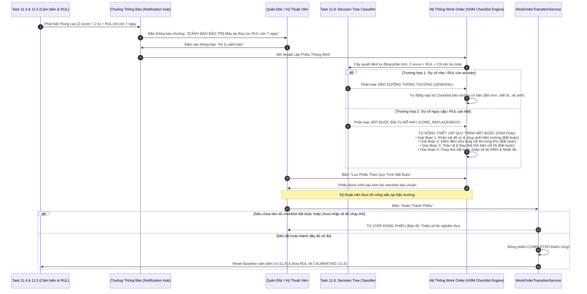

# Thiết Kế Hệ Thống & Đặc Tả Kỹ Thuật: Task 11.8 — Quy Trình Bảo Trì Chuyên Sâu & Quản Lý Cơ Sở Vật Chất (Decision Tree & HSM Checklist)

Tài liệu này xác định kiến trúc điều phối quy trình bảo trì chuyên sâu & theo dõi cơ sở vật chất trong hệ thống Quản lý Tài sản Doanh nghiệp (EAM). Hệ thống giải quyết trọn vẹn bài toán: **Tự động chuyển hóa các cảnh báo cảm biến (Task 11.4) và dự báo tuổi thọ RUL (Task 11.5) thành Lệnh làm việc (Work Order) có Quy trình Checklist bắt buộc chuẩn mực**.

Hệ thống kết hợp hài hòa 3 trụ cột:
1. **Mô hình Cây quyết định giải thích được (Explainable Decision Tree Classifier)**: Tự động phân tích các chỉ số cảnh báo để phân loại mức độ sự cố thành: *Bảo dưỡng thông thường* hay *Đại tu bổ máy cốt lõi (`CORE_REPLACEMENT`)*.
2. **Động cơ Quy trình Phân cấp (Hierarchical State Machine - HSM Checklist Engine)**: Tự động soạn thảo và áp đặt bộ **Checklist theo Giai đoạn bắt buộc** (Khảo sát $\to$ Vật tư sẵn sàng $\to$ Thay thế cốt lõi $\to$ Nghiệm thu đo rung/nhiệt), khóa cứng không cho thợ làm ẩu hoặc bỏ bước.
3. **Danh mục Cụm chi tiết cơ sở vật chất (Facility Component Catalog)**: Quản lý chi tiết cấu trúc máy móc theo phả hệ 3-4 tầng (*Khu vực $\to$ Máy móc $\to$ Cụm chi tiết*), định danh chính xác bộ phận bị hỏng hóc.

Tài liệu là **Đặc Tả Kỹ Thuật & Chuẩn Kiểm Thử (Technical Specification & Audit Baseline)** bám sát $100\%$ cam kết trong Đề cương tốt nghiệp đại học đã nộp cho nhà trường.

---

## 1. Mục Tiêu & Cơ Sở Khoa Học Theo Đề Cương Tốt Nghiệp

Trong Đề cương tốt nghiệp [`DeCuong_1150080143_VoAnhKiet.docx`](file:///C:/Users/Admin/Downloads/DATN/DeCuong_1150080143_VoAnhKiet.docx), yêu cầu nghiệp vụ được cam kết nguyên văn tại **Mục 104 (Kết quả dự kiến đạt được)** và **Mục 3.1.2 (Quy trình nghiệp vụ cốt lõi)**:
> *"Chức năng quản lý quy trình bảo trì hoàn thiện có khả năng theo dõi cơ sở vật chất, được xây dựng từ **mô hình cây quyết định Decision Tree phân loại mức độ sự cố kết hợp giải thuật máy trạng thái phân cấp Hierarchical State Machine** nhằm tự động thiết lập luồng quy trình xử lý riêng biệt cho các ca hỏng hóc phức tạp cần sửa chữa nhiều lần, kết hợp hệ thống báo cáo động toàn diện cho ban quản lý."*

### 1.1. Thực Trạng Nghiệp Vụ & Nhu Cầu Tự Động Soạn Checklist Chuẩn
Trong công tác bảo trì công nghiệp thực tế:
- **Người dùng lúng túng khi tạo phiếu**: Khi nhận được cảnh báo máy rung lắc hoặc sắp hỏng, Quản đốc thường không biết phải giao những đầu việc cụ thể nào cho thợ, dẫn đến việc tạo phiếu sơ sài (chỉ ghi "sửa máy") mà không có tiêu chuẩn kỹ thuật rõ ràng.
- **Thợ làm tắt, nhảy bước**: Thợ cơ khí thường bỏ qua bước khảo sát hiện trạng, không kiểm tra phụ tùng có sẵn hay không đã vội tháo máy, hoặc sửa xong không đo kiểm tra lại mà đã bấm "Hoàn thành" để kịp chỉ tiêu.
- **Vai trò của Task 11.8**:
  - Đóng vai trò là **Bộ trợ lý thông minh (Smart Dispatcher)** kết nối trực tiếp với chuông cảnh báo của Task 11.4 & 11.5.
  - Khi có cảnh báo rung chấn hoặc tuổi thọ cạn kiệt, **Cây quyết định (Decision Tree)** lập tức phân tích: Đây là ca sửa nhẹ (châm dầu, siết ốc) hay bắt buộc phải **Đại tu bổ máy cốt lõi**?
  - Nếu là ca đại tu, hệ thống **tự động nạp Quy trình HSM chuẩn gồm các Checklist bắt buộc khắt khe**, ép buộc thợ phải đo đạc số liệu sau sửa chữa mới cho đóng phiếu!

### 1.2. Cơ Chế Tích Hợp "Hòa Làm Một" Không Xung Đột Với Task 11.4 & Task 11.5
Rà soát mã nguồn hiện tại cho thấy Task 11.4 và Task 11.5 đã có sẵn một phần logic hỗ trợ tạo phiếu. Task 11.8 không tạo ra luồng mới cạnh tranh mà **nâng cấp và hoàn thiện trực tiếp** các điểm còn khuyết thiếu của luồng cũ:

1. **Đối với Task 11.4 (Phát hiện dị thường cảm biến)**:
   - *Hiện trạng trong Code*: Tại `notifications/services.py` (dòng 696-713) và `work_orders.html` (dòng 2835-2926), khi người dùng bấm vào thông báo có param `create_pm=1&alert_id=...`, JavaScript đang **gán cứng tĩnh 4 dòng checklist bằng tay** mà không có AI đánh giá, cũng không biết RUL của máy còn bao nhiêu.
   - *Giải pháp tích hợp 11.8*: Giữ nguyên URL và form modal của 11.4. Thay thế đoạn gán cứng bằng việc gọi API `evaluate-alert/` của Task 11.8. Cây quyết định tổng hợp cả Z-score (11.4) và RUL (11.5):
     - Nếu chỉ rung nhẹ và RUL còn dài $\rightarrow$ Giữ nguyên bộ checklist nhẹ như cũ.
     - Nếu máy có RUL $\le 15$ ngày hoặc rung nguy cấp $\rightarrow$ Cây quyết định tự động nâng cấp phiếu lên `CORE_REPLACEMENT` và thay bằng **bộ Checklist 4 giai đoạn đại tu bắt buộc**!
   - 👉 **Kết quả**: Không xung đột một dòng code hay URL nào, biến đoạn code gán cứng tĩnh thành trợ lý AI động thông minh.

2. **Đối với Task 11.5 (LSTM dự đoán RUL)**:
   - *Hiện trạng trong Code*: Tại `predictive_rul/service.py` (dòng 238-256), khi RUL chạm ngưỡng `CRITICAL`, hệ thống tự động sinh 1 Work Order dạng `PREDICTIVE_PM`, nhưng phiếu này **hoàn toàn trống rỗng checklist** (chưa có đầu việc cụ thể nào cho thợ).
   - *Giải pháp tích hợp 11.8*: Khi Task 11.5 tạo Work Order, nó gọi trực tiếp `DecisionTreeChecklistEngine.apply_overhaul_checklist(wo)` để tự động nạp bộ Checklist 4 giai đoạn bắt buộc vào phiếu.
   - 👉 **Kết quả**: Giải quyết triệt để vấn đề phiếu sinh ra bị rỗng, thợ mở phiếu ra đã có sẵn quy trình chuẩn.

3. **Đối với việc lập phiếu thủ công**:
   - Khi người dùng tạo phiếu thủ công và chọn một Thiết bị (`Asset`), nếu thiết bị đó đang có cảnh báo từ 11.4 hoặc 11.5, giao diện hiển thị banner trợ lý AI gợi ý Quản đốc áp dụng quy trình chuẩn chỉ bằng 1 cú click chuột.

---

## 2. Kiến Trúc Luồng Hoạt Động (End-to-End Workflow)



---

## 3. Đặc Tả 5 Quy Tắc Cốt Lõi (Core Business Rules)

### Quy Tắc 1: Cây Quyết Định Phân Loại Sự Cố Từ Cảnh Báo
- **Mô hình**: Sử dụng `DecisionTreeClassifier(max_depth=4, criterion='gini')` để phân loại sự cố dựa trên 4 đặc trưng đầu vào:
  1. $Z$-score dị biệt rung động / nhiệt độ (từ Task 11.4 `AssetAnomalyAlert`).
  2. Tuổi thọ hoạt động còn lại RUL (từ Task 11.5 `Asset.current_rul_days`).
  3. Tỷ lệ chi phí sửa chữa ước tính so với nguyên giá máy (`estimated_cost / Asset.purchase_cost`).
  4. Số lần hỏng hóc lặp lại trong 90 ngày gần nhất.
- **Hai nhánh phân loại chuẩn**:
  - **Nhánh 1 (`NORMAL_MAINTENANCE`)**: Z-score $< 2.0$, RUL $> 30$ ngày $\rightarrow$ Phân loại bảo dưỡng thông thường (`GENERAL` hoặc `MICRO_MAINTENANCE`).
  - **Nhánh 2 (`CRITICAL_OVERHAUL`)**: Z-score $\ge 2.5$ hoặc RUL $\le 15$ ngày hoặc có cảnh báo gia tốc nứt rỗ $\rightarrow$ Phân loại **Đại tu thay thế cốt lõi (`CORE_REPLACEMENT`)**.
- **Tính giải thích được (Explainable AI)**: Trích xuất đường dẫn IF-THEN minh bạch gửi kèm response:
  *Ví dụ: "RUL (7.0 ngày) <= 15 ngày ➔ Z-score rung chấn (2.85) >= 2.5 ➔ Phân loại: ĐẠI TU BỔ MÁY BẮT BUỘC (CORE_REPLACEMENT)"*.
- **Vùng đệm cảnh báo giáp ranh (`marginal_boundary_warning`)**: Nếu số liệu mấp mé ngưỡng $\pm 5\%$ (ví dụ RUL = 15.5 ngày, Z-score = 2.45), hệ thống bật cờ cảnh báo và yêu cầu Quản đốc review thủ công.

### Quy Tắc 2: Động Cơ Soạn Thảo Quy Trình Checklist Phân Cấp (HSM Checklist Engine)
Khi Work Order được xếp vào loại **Đại tu bổ máy (`CORE_REPLACEMENT`)**, hệ thống tự động sinh ra bộ **Quy trình Checklist 4 Giai đoạn bắt buộc**:
- **Giai đoạn 1: Khảo sát & Đánh giá hiện trạng (Bắt buộc)**:
  - Mục 1: `Kiểm tra độ rơ trục & xác nhận phương án tháo máy` (`PASS_FAIL`, `is_mandatory = True`).
  - Mục 2: `Đính kèm ít nhất 1 ảnh chụp hiện trạng máy trước khi tháo` (`is_mandatory = True`).
- **Giai đoạn 2: Kiểm đếm vật tư sẵn sàng (Bắt buộc)**:
  - Mục 3: `Xác nhận phụ tùng cốt lõi (vòng bi/bạc đạn) đã sẵn sàng trong kho` (`PASS_FAIL`, `is_mandatory = True`).
- **Giai đoạn 3: Thực hiện đại tu & Thay thế cốt lõi (Bắt buộc)**:
  - Mục 4: `Tháo rã cụm chi tiết, vệ sinh cổ trục & gia nhiệt lắp phụ tùng mới` (`PASS_FAIL`, `is_mandatory = True`).
- **Giai đoạn 4: Chạy thử & Đo nghiệm thu (Bắt buộc số liệu)**:
  - Mục 5: `Đo lại độ rung hiệu dụng sau chạy thử không tải (mm/s RMS)` (`NUMBER`, `is_mandatory = True`).
  - Mục 6: `Đo lại nhiệt độ ổ trục sau chạy thử (°C)` (`NUMBER`, `is_mandatory = True`).

### Quy Tắc 3: Rào Chắn Nghiệm Thu & Kiểm Tra Số Đo Chạy Thử
- Tận dụng trực tiếp rào chắn trong [`workorders/services.py`](file:///d:/GameLinkNeverDie/eam-enterprise-assset-management/eam_app/workorders/services.py#L110-L122):
  - Kỹ thuật viên **không thể bấm hoàn thành phiếu** nếu các checklist `is_mandatory = True` chưa được đánh dấu hoàn thành.
  - Đối với các mục kiểm tra kiểu `NUMBER` (độ rung, nhiệt độ), hệ thống bắt buộc phải có số liệu đo đạc thực tế, chống gian lận báo cáo khống.
- Nếu số đo độ rung sau sửa chữa vượt ngưỡng an toàn ($> 4.5\text{ mm/s}$ theo ISO 10816), hệ thống từ chối đóng phiếu và yêu cầu **Lùi bước (Rollback)** để thợ căn tâm cân bằng động lại.

### Quy Tắc 4: Cơ Chế Lùi Bước (Rollback) & Tạm Hoãn Ngoại Cảnh (`ON_HOLD`)
- **Lùi bước kỹ thuật (Rollback)**: Nếu trong quá trình chạy thử phát hiện tiếng kêu lạ hoặc rung lắc chưa đạt, Quản đốc có quyền bấm nút **"Yêu cầu làm lại (Rollback)"** $\rightarrow$ Hệ thống tự động chuyển trạng thái Checklist Giai đoạn 3 & 4 về chưa đạt (`is_completed = False`) kèm ghi chú lý do kỹ thuật bắt buộc $\ge 20$ ký tự để thợ sửa lại.
- **Tạm hoãn ngoại cảnh (`ON_HOLD`)**: Cho phép Quản đốc tạm hoãn phiếu khi phải chờ nhà cung cấp giao vòng bi nhập khẩu $\rightarrow$ Thời gian tạm hoãn được cộng dồn vào `hold_accumulated_seconds` và tự động trừ ra khỏi chỉ số đo lường hiệu suất SLA/MTTR.

### Quy Tắc 5: Tự Động Khép Kín Vòng Tròn AI (Baseline Reset Bridge)
- Khi phiếu đại tu cốt lõi (`CORE_REPLACEMENT`) được nghiệm thu hoàn thành:
  - **Reset Task 11.4**: Toàn bộ các bản ghi `MeterReading` trước thời điểm sửa chữa được đóng băng (`is_pre_repair = True`), các cảnh báo dị thường `AssetAnomalyAlert` chuyển sang `RESOLVED`.
  - **Reset Task 11.5**: Cập nhật mốc đại tu `Asset.last_core_overhaul_at = now`, xóa cờ hồi phục ảo `is_phantom_recovery = False`, và đưa trạng thái `rul_risk_level = 'CALIBRATING'` để bắt đầu chu kỳ giám sát tuổi thọ mới.

---

## 4. Mô Hình Dữ Liệu & Khóa Ngoại (Data Model & Schema)

### 4.1. Bảng `facility_components` (Cây cụm chi tiết cơ sở vật chất 3-4 tầng)
```sql
CREATE TABLE facility_components (
    id UUID PRIMARY KEY DEFAULT gen_random_uuid(),
    tenant_id UUID NOT NULL REFERENCES tenants(id) ON DELETE CASCADE,
    asset_id UUID NOT NULL REFERENCES assets(id) ON DELETE CASCADE,
    parent_id UUID NULL REFERENCES facility_components(id) ON DELETE CASCADE,
    code VARCHAR(64) NOT NULL,
    name VARCHAR(255) NOT NULL,
    criticality VARCHAR(16) NOT NULL DEFAULT 'MEDIUM', -- 'LOW', 'MEDIUM', 'HIGH', 'CRITICAL'
    created_at TIMESTAMP WITH TIME ZONE DEFAULT CURRENT_TIMESTAMP,
    updated_at TIMESTAMP WITH TIME ZONE DEFAULT CURRENT_TIMESTAMP,
    CONSTRAINT uq_comp_code_asset UNIQUE (tenant_id, asset_id, code)
);
CREATE INDEX idx_facility_components_asset ON facility_components(tenant_id, asset_id);
```

### 4.2. Mở rộng bảng `work_orders` (Bổ sung trường hỗ trợ Cây quyết định & HSM)
```sql
ALTER TABLE work_orders
    ADD COLUMN severity_level VARCHAR(32) NULL, -- 'NORMAL_MAINTENANCE', 'CRITICAL_OVERHAUL'
    ADD COLUMN marginal_boundary_warning BOOLEAN DEFAULT FALSE,
    ADD COLUMN decision_path_explanation TEXT NULL,
    ADD COLUMN override_reason TEXT NULL,
    ADD COLUMN is_on_hold BOOLEAN DEFAULT FALSE,
    ADD COLUMN hold_reason VARCHAR(64) NULL, -- 'WAITING_PARTS', 'WAITING_VENDOR', 'BUDGET_APPROVAL'
    ADD COLUMN hold_started_at TIMESTAMP WITH TIME ZONE NULL,
    ADD COLUMN hold_accumulated_seconds INT DEFAULT 0,
    ADD COLUMN component_id UUID NULL REFERENCES facility_components(id) ON DELETE SET NULL;
```

### 4.3. Bảng `hsm_stage_transitions` (Lịch sử đánh giá AI & Lùi bước kỹ thuật)
```sql
CREATE TABLE hsm_stage_transitions (
    id UUID PRIMARY KEY DEFAULT gen_random_uuid(),
    tenant_id UUID NOT NULL REFERENCES tenants(id) ON DELETE CASCADE,
    work_order_id UUID NOT NULL REFERENCES work_orders(id) ON DELETE CASCADE,
    action_type VARCHAR(32) NOT NULL, -- 'AI_EVALUATE', 'OVERRIDE', 'ROLLBACK', 'HOLD', 'RESUME'
    severity_assigned VARCHAR(32) NULL,
    reason TEXT NULL,
    performed_by_id UUID NOT NULL REFERENCES users(id) ON DELETE CASCADE,
    vibration_reading FLOAT NULL,
    temperature_reading FLOAT NULL,
    created_at TIMESTAMP WITH TIME ZONE DEFAULT CURRENT_TIMESTAMP
);
CREATE INDEX idx_hsm_transitions ON hsm_stage_transitions(tenant_id, work_order_id, created_at);
```

---

## 5. Đặc Tả Giao Diện Lập Trình (RESTful APIs)

### 5.1. Danh Mục Endpoints

| Phương thức | Đường dẫn | Chức năng | Phân quyền |
| :--- | :--- | :--- | :--- |
| `POST` | `/api/v1/work-orders/evaluate-alert/` | Cây quyết định phân tích dữ liệu cảnh báo và sinh gợi ý Checklist | `work_order:create` / `work_order:update` |
| `POST` | `/api/v1/work-orders/{id}/hsm-rollback/` | Quản đốc yêu cầu làm lại (Rollback checklist chạy thử về sửa chữa) | `work_order:reassign` (Quản đốc) |
| `POST` | `/api/v1/work-orders/{id}/hsm-hold/` | Kích hoạt tạm hoãn `ON_HOLD` hoặc tiếp tục `RESUME` | `work_order:update` |
| `GET` | `/api/v1/assets/{id}/components/` | Lấy danh mục cụm chi tiết cơ sở vật chất của máy | Toàn bộ nhân viên kỹ thuật |

### 5.2. Cấu Trúc Dữ Liệu Trao Đổi Mẫu

#### Phân tích cảnh báo & Sinh Checklist tự động (`POST /api/v1/work-orders/evaluate-alert/`):
*Payload Request*:
```json
{
  "assetId": "9b1deb4d-3b7d-4bad-9bdd-2b0d7b3dcb6d",
  "alertId": "e3b0c442-98fc-1c14-9afb-f4c8996fb924",
  "anomalyZscore": 2.85,
  "currentRulDays": 7.0,
  "estimatedCost": 25000000
}
```

*Response `200 OK` (AI Phán Quyết Đại Tu & Tự Động Soạn Checklist)*:
```json
{
  "success": true,
  "data": {
    "suggestedSeverity": "CRITICAL_OVERHAUL",
    "suggestedMaintenanceAction": "CORE_REPLACEMENT",
    "marginalBoundaryWarning": false,
    "decisionPathExplanation": "RUL còn lại (7.0 ngày) <= 15.0 ngày ➔ Z-score rung chấn (2.85) >= 2.50 ➔ Phân loại: ĐẠI TU BỔ MÁY BẮT BUỘC (CORE_REPLACEMENT)",
    "suggestedPriority": "URGENT",
    "suggestedTitle": "Đại tu bổ máy cốt lõi: Thay thế cụm vòng bi trục chính",
    "suggestedChecklists": [
      {
        "stage": "DIAGNOSIS",
        "itemName": "Khảo sát độ rơ trục & xác nhận phương án bổ máy",
        "inputType": "PASS_FAIL",
        "expectedValue": "PASS",
        "isMandatory": true
      },
      {
        "stage": "DIAGNOSIS",
        "itemName": "Đính kèm ít nhất 1 ảnh chụp hiện trạng máy trước khi tháo",
        "inputType": "PASS_FAIL",
        "expectedValue": "PASS",
        "isMandatory": true
      },
      {
        "stage": "STAGING_PARTS",
        "itemName": "Xác nhận phụ tùng cốt lõi (vòng bi SKF 6205) đã sẵn sàng trong kho",
        "inputType": "PASS_FAIL",
        "expectedValue": "PASS",
        "isMandatory": true
      },
      {
        "stage": "OVERHAUL_EXECUTION",
        "itemName": "Tháo rã cụm nắp, vệ sinh cổ trục & gia nhiệt lắp vòng bi mới",
        "inputType": "PASS_FAIL",
        "expectedValue": "PASS",
        "isMandatory": true
      },
      {
        "stage": "TRIAL_ACCEPTANCE",
        "itemName": "Đo lại độ rung hiệu dụng sau 30 phút chạy thử không tải (mm/s RMS)",
        "inputType": "NUMBER",
        "expectedValue": "< 4.5",
        "isMandatory": true
      },
      {
        "stage": "TRIAL_ACCEPTANCE",
        "itemName": "Đo lại nhiệt độ gối đỡ sau chạy thử (°C)",
        "inputType": "NUMBER",
        "expectedValue": "< 75.0",
        "isMandatory": true
      }
    ]
  }
}
```

---

## 6. Đặc Tả Giao Diện Người Dùng (UI/UX Web Portal)

Tích hợp trực tiếp trên trang [`work_orders.html`](file:///d:/GameLinkNeverDie/eam-enterprise-assset-management/eam_app/templates/work_orders.html):

1. **Khung Trợ Lý AI Lập Phiếu (AI Workflow Assistant Card)**:
   - Khi mở modal tạo phiếu từ thông báo cảnh báo (có param `alert_id`), hệ thống hiển thị một khung thẻ nổi bật màu chàm (indigo):
     - Huy hiệu phân loại: `ĐẠI TU BỔ MÁY (CORE_REPLACEMENT)` (nổi bật màu đỏ cam).
     - Hộp giải thích luật IF-THEN rõ ràng, thuyết phục.
     - Nút bấm: **"Áp Dụng Quy Trình Checklist Chuẩn Bắt Buộc"**.
   - Khi bấm, form tự động điền tiêu đề, gắn cờ `CORE_REPLACEMENT`, và render toàn bộ danh mục 4 giai đoạn checklist vào bảng checklist phía dưới.

2. **Hiển Thị Phân Giai Đoạn Trên Bảng Checklist**:
   - Các dòng checklist được nhóm theo 4 badge giai đoạn trực quan:
     - `[GĐ 1: Khảo sát]`
     - `[GĐ 2: Vật tư]`
     - `[GĐ 3: Thao tác đại tu]`
     - `[GĐ 4: Nghiệm thu chạy thử]`
   - Các mục có `is_mandatory = True` hiển thị dấu sao đỏ `*` và badge `Bắt buộc`.
   - Các mục kiểu `NUMBER` hiển thị ô nhập số liệu với đơn vị đo tương ứng.

3. **Nút "Yêu cầu làm lại (Rollback)" trong màn hình chi tiết**:
   - Dành cho Quản đốc khi nghiệm thu: Nếu thấy thợ nhập số đo rung còn cao hoặc máy còn kêu, bấm "Yêu cầu làm lại" để chuyển trạng thái checklist về chưa đạt và gửi thông báo cho thợ.

---

## 7. Tiêu Chí Chấp Nhận & Ma Trận Kiểm Thử (Acceptance Criteria & Test Matrix)

| Mã Test | Tên Kịch Bản | Điều Kiện Thử Nghiệm | Hành Vi Kỳ Vọng |
| :--- | :--- | :--- | :--- |
| **TC-HSM-01** | Phân loại Bảo dưỡng thông thường | Z-score = 1.2, RUL = 45 ngày | AI phân loại `NORMAL_MAINTENANCE`, sinh checklist bảo dưỡng nhẹ |
| **TC-HSM-02** | Phân loại Đại tu bổ máy | Z-score = 2.8, RUL = 6 ngày | AI phân loại `CRITICAL_OVERHAUL`, tự động sinh 6 checklist 4 giai đoạn |
| **TC-HSM-03** | Cảnh báo vùng đệm giáp ranh | RUL = 15.2 ngày (sát ngưỡng 15.0) | Gắn cờ `marginal_boundary_warning = True`, yêu cầu Quản đốc xác nhận |
| **TC-HSM-04** | Tự động điền form từ thông báo | Mở modal tạo phiếu với `alert_id` | Tự động gọi AI evaluate và điền sẵn tiêu đề, loại phiếu, checklist |
| **TC-HSM-05** | Chặn hoàn thành khi thiếu checklist | Bấm Hoàn thành khi mục Khảo sát chưa đánh dấu | Chặn đóng phiếu, báo lỗi: `Chưa hoàn thành bước bắt buộc` |
| **TC-HSM-06** | Chặn hoàn thành khi thiếu số đo | Mục đo rung kiểu `NUMBER` để trống | Chặn đóng phiếu, báo lỗi: `Mục bắt buộc chưa có số liệu đo kiểm` |
| **TC-HSM-07** | Chấp nhận hoàn thành khi đủ số đo | Đánh dấu đủ checklist và nhập số đo hợp lệ | Chấp thuận hoàn thành phiếu (`COMPLETED`) thành công |
| **TC-HSM-08** | Lùi bước kỹ thuật (Rollback) | Quản đốc bấm Rollback do số đo rung chưa đạt | Chuyển checklist chạy thử về `False`, lưu vết lý do lùi bước |
| **TC-HSM-09** | Tạm hoãn ngoại cảnh đóng băng SLA | Bật trạng thái `ON_HOLD` do chờ phụ tùng | Thời gian chờ được tích lũy vào `hold_accumulated_seconds` |
| **TC-HSM-10** | Tái đồng bộ Baseline sau đại tu | Nghiệm thu hoàn tất phiếu `CORE_REPLACEMENT` | Đóng băng số đo cũ (11.4) và đưa RUL về `CALIBRATING` (11.5) |

---

## 8. Kế Hoạch Triển Khai Chi Tiết (Implementation Checklist)

- [ ] **Task 11.8.1 — Database Models & Migrations**
  - [ ] Tạo model `FacilityComponent` quản lý cụm chi tiết cơ sở vật chất.
  - [ ] Mở rộng model `WorkOrder`: `severity_level`, `marginal_boundary_warning`, `decision_path_explanation`, `override_reason`, `is_on_hold`, `hold_accumulated_seconds`, `component`.
  - [ ] Tạo model `HsmStageTransition` lưu vết đánh giá AI và lùi bước.
  - [ ] Chạy migration Django hoàn tất.

- [ ] **Task 11.8.2 — Decision Tree & Checklist Template Engine**
  - [ ] Xây dựng service `DecisionTreeChecklistEngine` tại `eam_app/algorithms/decision_tree_hsm/engine.py`.
  - [ ] Cài đặt luật phân loại Cây quyết định kết nối dữ liệu từ 11.4 & 11.5.
  - [ ] Cài đặt kho mẫu Checklist chuẩn 4 giai đoạn cho các ca đại tu bổ máy cốt lõi.
  - [ ] Xây dựng API `POST /api/v1/work-orders/evaluate-alert/`.

- [ ] **Task 11.8.3 — Workflow Rollback & On-Hold Service**
  - [ ] Cài đặt logic Lùi bước kỹ thuật (Rollback checklist).
  - [ ] Cài đặt logic tạm hoãn `ON_HOLD` và tích lũy thời gian đóng băng SLA.

- [ ] **Task 11.8.4 — UI Integration on `work_orders.html`**
  - [ ] Tích hợp khung trợ lý AI vào modal tạo Work Order khi mở từ thông báo cảnh báo.
  - [ ] Hiển thị badge giai đoạn và trường nhập số đo cho các checklist bắt buộc.
  - [ ] Thêm nút Rollback cho Quản đốc trong modal chi tiết phiếu.

- [ ] **Task 11.8.5 — Test Verification**
  - [ ] Viết bộ test kiểm chứng 10 kịch bản (`TC-HSM-01` $\to$ `TC-HSM-10`).
